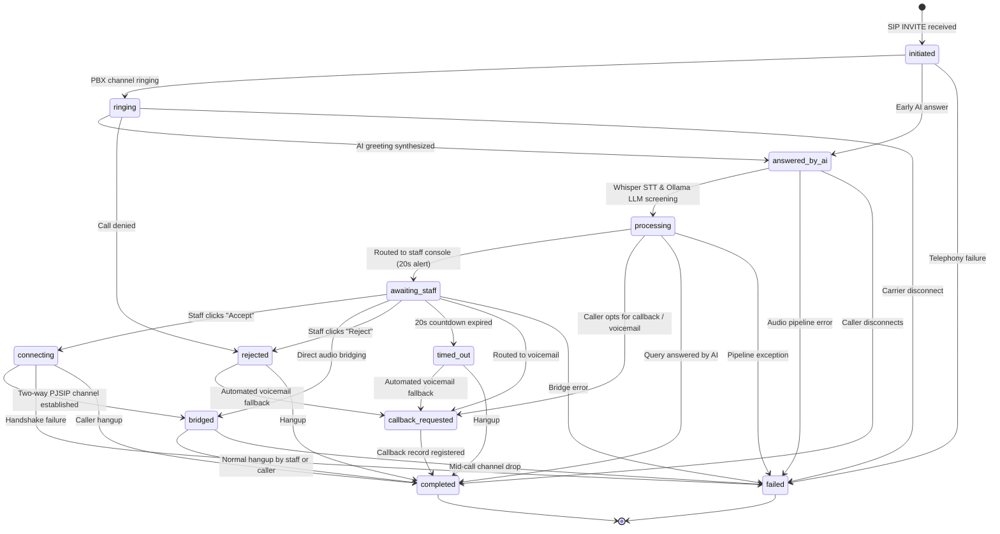

# SDS Voice Intelligence – Call State Machine Specification

## 1. Overview & Architectural Principles

The Call State Machine is a centralized, deterministic finite state machine (FSM) implemented in `backend/src/services/callStateMachine.ts`. It governs the complete lifecycle of inbound telephone calls from the moment an Asterisk SIP channel is initiated through AI screening, department routing, staff console dispatch, audio bridging, and call completion or fallback.

---

## 2. Finite State Transition Diagram

---

## 3. Permitted Transition Matrix

| Current State | Permitted Next States | Description / Trigger |
| :--- | :--- | :--- |
| `initiated` | `ringing`, `answered_by_ai`, `failed` | Inbound SIP channel signaled from PBX trunk |
| `ringing` | `answered_by_ai`, `rejected`, `failed`, `completed` | Telephony channel is ringing |
| `answered_by_ai` | `processing`, `failed`, `completed` | Virtual assistant answers, synthesizes opening greeting |
| `processing` | `awaiting_staff`, `callback_requested`, `completed`, `failed` | Whisper transcription & Ollama intent extraction in progress |
| `awaiting_staff` | `connecting`, `bridged`, `rejected`, `timed_out`, `callback_requested`, `failed` | Call alert dispatched to staff reception console with 20s timer |
| `connecting` | `bridged`, `failed`, `completed` | Staff extension answered; PJSIP bridge being established |
| `bridged` | `completed`, `failed` | Caller and staff extension connected in 2-way audio conversation |
| `rejected` | `callback_requested`, `completed` | Staff declined incoming screened call alert |
| `timed_out` | `callback_requested`, `completed` | Staff extension did not answer within configured routing timeout (e.g. 20s) |
| `callback_requested` | `completed` | Caller requested callback or was routed to department voicemail queue |
| `failed` | *(Terminal)* | Telephony or system error terminated call |
| `completed` | *(Terminal)* | Call ended normally and resources were released |

---

## 4. Reconciled Database Schema Mapping

The Phase 5 FSM reconciles the specification's 5 required states with the existing database schema (`public.calls.status CHECK constraint` in `20261101000001_core_schema.sql`):

1. **`initiated`** *(Required)*: Master record created when inbound call enters the system.
2. **`answered_by_ai`** *(Required)*: Telephony channel answered; local TTS greeting played.
3. **`processing`** *(Required)*: Audio buffer captured; STT (Whisper) and LLM (Ollama) classification active.
4. **`awaiting_staff`** *(Required)*: Call evaluated by Intelligent Routing Engine; dispatched to staff console.
5. **`bridged`** *(Required)*: ARI bridge active between caller and staff PJSIP channel.
6. **`ringing`** *(Telephony constraint)*: Early SIP signaling state before audio stream opens.
7. **`connecting`** *(Telephony constraint)*: Intermediate channel dial state when bridging to extension.
8. **`completed`** *(Operational)*: Call terminated normally. `ended_at` timestamp stamped, duration calculated.
9. **`rejected`** *(Operational)*: Staff clicked "Reject" / "Send to Voicemail".
10. **`timed_out`** *(Operational)*: Routing timeout reached without staff answer.
11. **`callback_requested`** *(Operational)*: Voicemail or scheduled callback queued.
12. **`failed`** *(Operational)*: Channel failure or unrecoverable error.

---

## 5. Concurrency & Idempotency Controls

### 5.1 Mutex Locking
To protect against race conditions caused by simultaneous API calls or concurrent webhook/telephony events:
- An in-memory mutex (`acquireCallLock` / `releaseCallLock`) is acquired prior to reading and transitioning call state.
- If another request holds the lock on the same `callId`, the incoming request is immediately rejected with HTTP 409 `CALL_STATE_CONCURRENCY_CONFLICT` (`CallStateConcurrencyError`).

### 5.2 Idempotency Protection
- When an API client or retry mechanism requests a transition to the state the call is already in (e.g. `awaiting_staff` -> `awaiting_staff`), the transition is treated as an idempotent no-op. The current record is returned without corrupting timestamps or logging duplicate audit trails.

### 5.3 Invalid Transition Rejection
- Attempting any transition not defined in `PERMITTED_TRANSITIONS` throws `InvalidStateTransitionError` (HTTP 400). The error response explicitly returns `currentStatus`, `targetStatus`, and `permittedTransitions`.

---

## 6. Audit Logging & Real-Time Event Dispatch

Every state transition automatically triggers:
1. **Audit Trail:** An append-only record inserted into `audit_logs` containing `action: 'CALL_STATE_TRANSITION'`, `entityType: 'call'`, previous status, target status, reason, duration, and triggering user ID.
2. **Socket.IO Event:** Dispatches `call:status_changed` to `role:admin`, `role:operator`, and the call's assigned `dept:${departmentId}` room.
