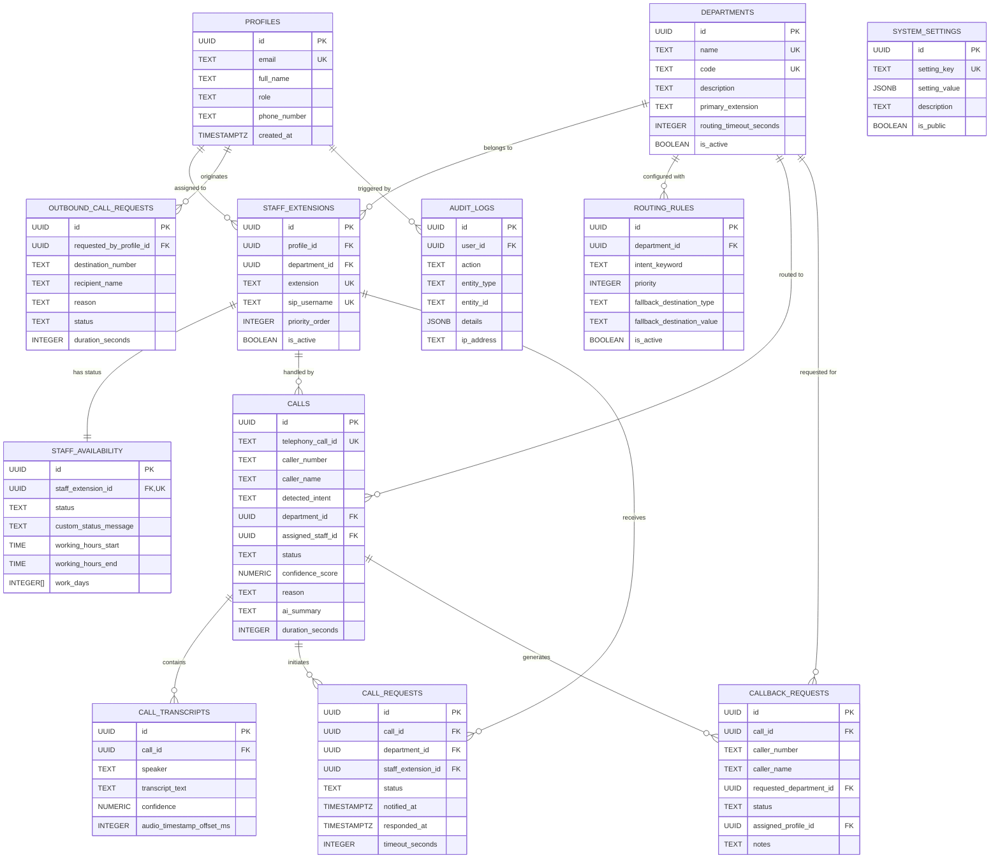

# Database Schema & Security Specification (Phase 3)

## 1. Relational Architecture & ER Diagram

---

## 2. Table Definitions & Constraints

### 1. `profiles`
- Extends Supabase `auth.users` with application profile data.
- **Primary Key:** `id` (UUID references `auth.users(id)` ON DELETE CASCADE).
- **Constraints:** `email` UNIQUE NOT NULL; `role` CHECK IN (`'admin'`, `'staff'`, `'operator'`).
- **Indexes:** `idx_profiles_role`, `idx_profiles_email`.

### 2. `departments`
- Institutional operational units (e.g. Admissions, Examination, Accounts).
- **Primary Key:** `id` (UUID default `uuid_generate_v4()`).
- **Constraints:** `name` UNIQUE NOT NULL; `code` UNIQUE NOT NULL; `routing_timeout_seconds` between 5 and 120.
- **Indexes:** `idx_departments_is_active`, `idx_departments_code`.

### 3. `staff_extensions`
- Maps staff profiles to physical/virtual SIP endpoints (PJSIP).
- **Primary Key:** `id` (UUID).
- **Foreign Keys:** `profile_id` -> `profiles(id)` ON DELETE CASCADE; `department_id` -> `departments(id)` ON DELETE RESTRICT.
- **Constraints:** `extension` UNIQUE NOT NULL; `sip_username` UNIQUE NOT NULL; `priority_order` >= 1.
- **Indexes:** `idx_staff_ext_dept`, `idx_staff_ext_profile`, `idx_staff_ext_extension`.

### 4. `staff_availability`
- Real-time presence and work schedule tracking.
- **Primary Key:** `id` (UUID).
- **Foreign Key:** `staff_extension_id` -> `staff_extensions(id)` ON DELETE CASCADE (UNIQUE).
- **Constraints:** `status` CHECK IN (`'available'`, `'busy'`, `'away'`, `'do_not_disturb'`, `'offline'`).
- **Indexes:** `idx_staff_avail_status`.

### 5. `routing_rules`
- Rules matching LLM extracted keywords to departments and fallback strategies.
- **Primary Key:** `id` (UUID).
- **Foreign Key:** `department_id` -> `departments(id)` ON DELETE CASCADE.
- **Constraints:** `fallback_destination_type` CHECK IN (`'operator'`, `'voicemail'`, `'extension'`, `'external_number'`).
- **Indexes:** `idx_routing_rules_dept`, `idx_routing_rules_keyword`.

### 6. `calls`
- Central call log tracking the complete call state machine lifecycle.
- **Primary Key:** `id` (UUID).
- **Constraints:** `status` CHECK IN (`'initiated'`, `'ringing'`, `'answered_by_ai'`, `'processing'`, `'awaiting_staff'`, `'connecting'`, `'bridged'`, `'completed'`, `'rejected'`, `'timed_out'`, `'failed'`, `'callback_requested'`).
- **Foreign Keys:** `department_id` -> `departments(id)` ON DELETE SET NULL; `assigned_staff_id` -> `staff_extensions(id)` ON DELETE SET NULL.
- **Indexes:** `idx_calls_status`, `idx_calls_dept`, `idx_calls_staff`, `idx_calls_caller`, `idx_calls_created_at`.

### 7. `call_transcripts`
- Utterances recorded during AI screening and bridging.
- **Primary Key:** `id` (UUID).
- **Foreign Key:** `call_id` -> `calls(id)` ON DELETE CASCADE.
- **Constraints:** `speaker` CHECK IN (`'ai'`, `'caller'`, `'staff'`).
- **Indexes:** `idx_transcripts_call_id`.

### 8. `call_requests`
- Real-time screening notifications dispatched to staff dashboards during incoming call evaluation.
- **Primary Key:** `id` (UUID).
- **Foreign Keys:** `call_id` -> `calls(id)` ON DELETE CASCADE; `department_id` -> `departments(id)` ON DELETE RESTRICT; `staff_extension_id` -> `staff_extensions(id)` ON DELETE SET NULL.
- **Constraints:** `status` CHECK IN (`'awaiting_staff'`, `'accepted'`, `'rejected'`, `'timed_out'`, `'cancelled'`).
- **Indexes:** `idx_call_requests_call_id`, `idx_call_requests_staff_id`, `idx_call_requests_status`.

### 9. `callback_requests`
- Message-taking and callback requests generated on unanswered calls or caller choice.
- **Primary Key:** `id` (UUID).
- **Constraints:** `status` CHECK IN (`'pending'`, `'assigned'`, `'in_progress'`, `'completed'`, `'cancelled'`).
- **Indexes:** `idx_callback_status`, `idx_callback_dept`, `idx_callback_assigned`.

### 10. `outbound_call_requests`
- Outgoing calls initiated through web dashboard.
- **Primary Key:** `id` (UUID).
- **Constraints:** `status` CHECK IN (`'requested'`, `'initiating'`, `'ringing'`, `'answered'`, `'failed'`, `'busy'`, `'no_answer'`, `'completed'`).
- **Indexes:** `idx_outbound_status`, `idx_outbound_profile`.

### 11. `audit_logs`
- Append-only security and operational audit trail.
- **Primary Key:** `id` (UUID).
- **Foreign Key:** `user_id` -> `profiles(id)` ON DELETE SET NULL.
- **Indexes:** `idx_audit_created_at`, `idx_audit_user_id`, `idx_audit_entity`.

### 12. `system_settings`
- Dynamic administrative configuration without code modifications.
- **Primary Key:** `id` (UUID).
- **Constraints:** `setting_key` UNIQUE NOT NULL; `setting_value` JSONB NOT NULL.
- **Indexes:** `idx_settings_key`.

---

## 3. Row Level Security (RLS) Policy Matrix

| Table | Admin Role | Staff Role | Operator Role |
| :--- | :--- | :--- | :--- |
| `profiles` | Full CRUD | View all, edit self | View all, edit self |
| `departments` | Full CRUD | Read-only | Read-only |
| `staff_extensions` | Full CRUD | Read-only | Read-only |
| `staff_availability`| Full CRUD | View all, edit own status | View all, edit own status |
| `routing_rules` | Full CRUD | Read-only | Read-only |
| `calls` | Full CRUD | View & update assigned/dept calls | View & update all calls |
| `call_transcripts` | Full CRUD | View assigned/dept transcripts | View all transcripts |
| `call_requests` | Full CRUD | View/accept/reject assigned requests | View all requests |
| `callback_requests`| Full CRUD | View/update assigned/dept callbacks | View/update all callbacks |
| `outbound_call_requests` | Full CRUD | Create & view own outbound calls | Create & view own outbound calls |
| `audit_logs` | Read-only (Immutable) | Append only (No read access) | Append only (No read access) |
| `system_settings` | Full CRUD | Read public settings only | Read public settings only |
